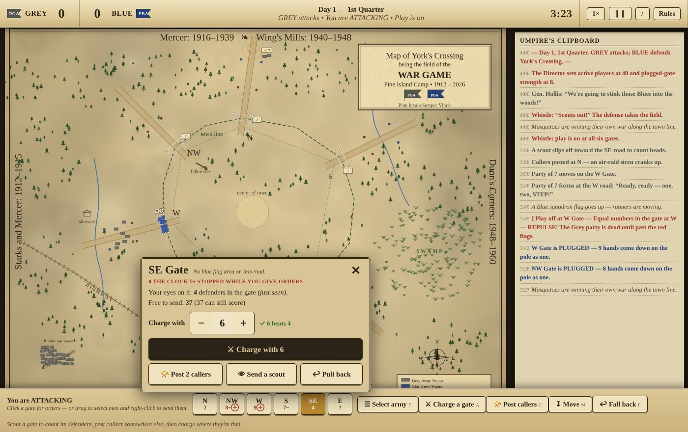

# The War Game — York's Crossing

A video game of the **Pine Island Camp War Game**, played in the Maine woods every summer since 1912 — and nowhere else on Earth.

## Play

**[▶ Play in your browser](https://jatreat.github.io/the-war-game/)** — or download `index.html` and open it. One file, no install, no dependencies.

You are the General. Take command of the Grey Army or the Blue Army and fight a full two-day match: four quarters, attacking twice and defending twice, against an AI general (Camper, Counselor, or General difficulty). Most points after the final whistle wins.

Name both generals on the title screen. The dice draw a real War Game general from camp history — the Grey and Blue generals named in *The Pine Needle* since 2003, plus legends from earlier decades — or type any name you like. Your choices are remembered on your device. Plays on phones, tablets and computers.

## The game

Picture an invisible town surrounded by wilderness, with six gates — N, NW, W, S, SE, E — each at the end of a road marked with white, red, and blue flags.

**Attacking:** move parties through the woods, post callers to make an unholy racket at gates you don't intend to hit, and when you find a weak gate, step in together — *"Ready, ready — one, two, STEP!"* Outnumber the defenders inside and every eligible man scores a point. Equal numbers is a **repulse**. A **plugged gate** repulses any number.

**Defending:** you have 40 men and it takes 8 to plug a gate. Six gates. Do the arithmetic — the whole game lives in it. Read the scout reports, shuffle squadrons, don't chase noise, and when you're ahead late, call **Lockdown**.

The umpire logic implements the 2018 Revision of the rules: scoring points, challenge points (worth **three times** the difference in a blue flag area), repulses, the whistle and play-off procedure, and the per-man limits — three points per game, no more than two in your army's first attack period, with scored men walking hands-on-head past the blue flags, or to the Center of Town, dead for the period.

## Controls

**Tap or click a gate** — on the map, or one of the six gate buttons along the bottom. A panel shows what your army knows about that gate and the orders you can give:

- **Attacking:** charge with a set number of men, post two callers, send a scout to count heads, or pull back. The panel tells you whether your number beats what's been seen inside.
- **Defending:** hold the gate with a set number, plug it, or lock down all six. Turn on the **Aide-de-camp** if you'd like help shuffling squadrons; he leaves any gate you set by hand alone.

You pick the job and the number; the nearest free men go. The game still plays by every rule below — the panel is just a faster way to give the same orders.

By default the clock stops while an order panel is open (switch it off on the title screen). On a phone: pinch to zoom, drag to look around, double-tap to zoom.

**Classic controls** still work with a mouse: drag to select men, right-click to move (or charge, on a gate), scroll to zoom. Keys: `1`–`6` grab a gate's garrison, `A` charge, `C` callers, `G` send to gate, `S` sprint, `L` lockdown, `F` fall back, `Space` pause, `Esc` close a panel. The **Rules** button in-game has the full summary.

## Provenance

The War Game (originally the King's Game) has been played by Pine Island Camp since 1912, across fields at Starks and Mercer, Mercer, Wing's Mills, Dunn's Corners, Fogg's Forks, and, since 1970, York's Crossing. This digital version was built from the 2018 Revision of the rules and the history recorded in Robert Moor's *Down East* article "The War Game." The map is an original recreation in the style of the 100th-anniversary map of York's Crossing.

The War Game itself belongs to Pine Island Camp and its campers. This is a fan-made tribute by a Grey general.

And it is *Grey* — with an E.
